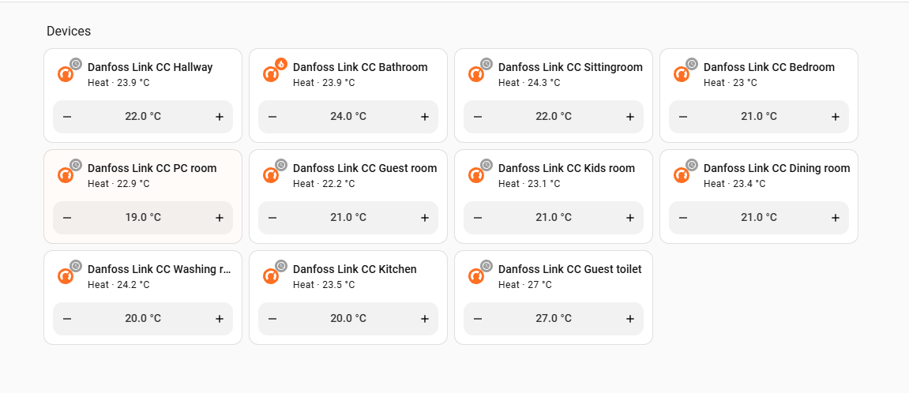
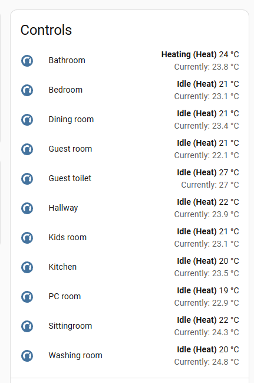
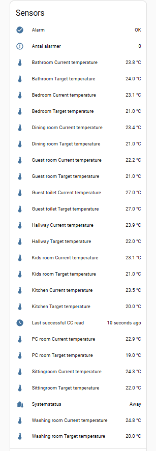
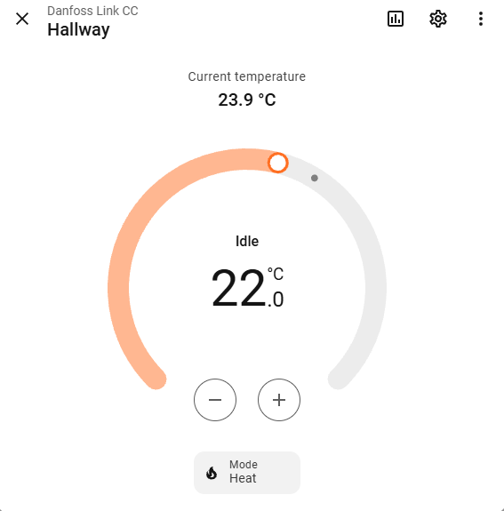
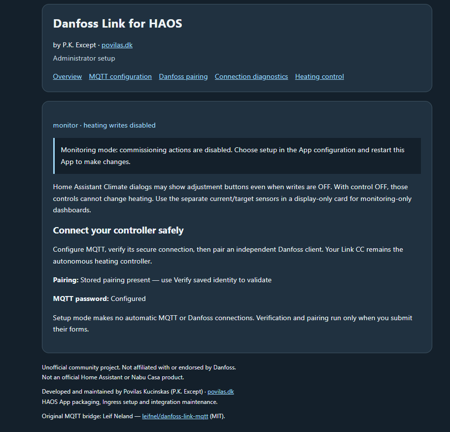
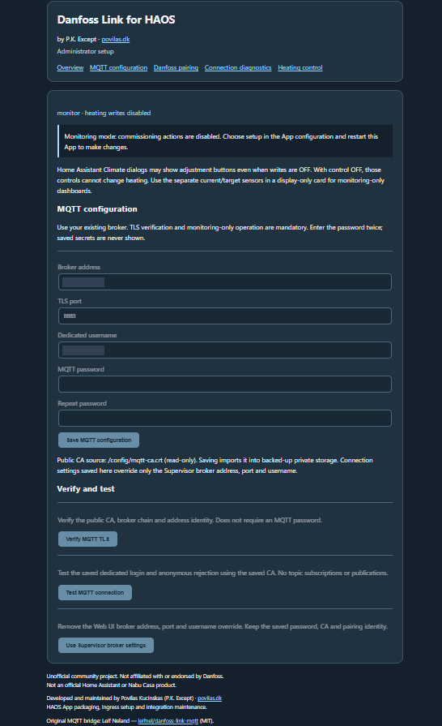
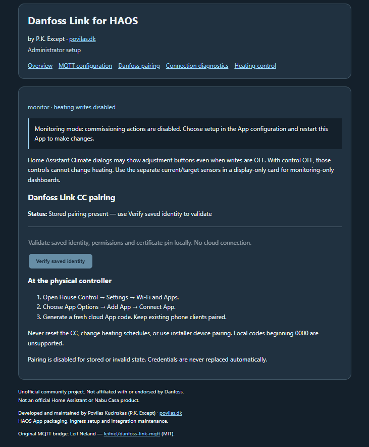
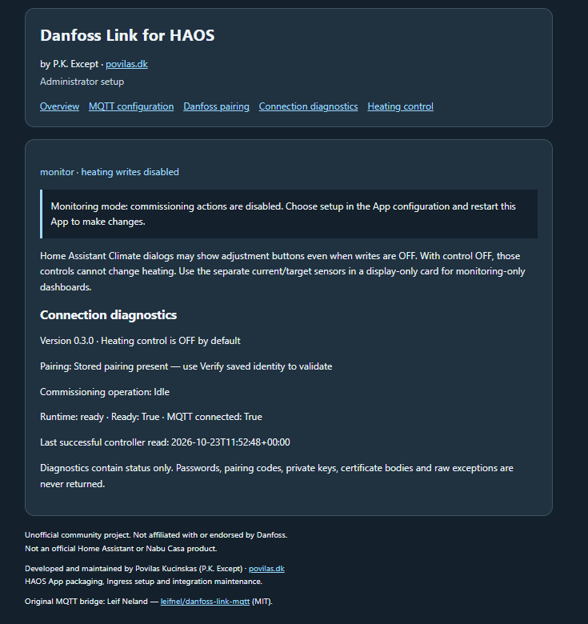
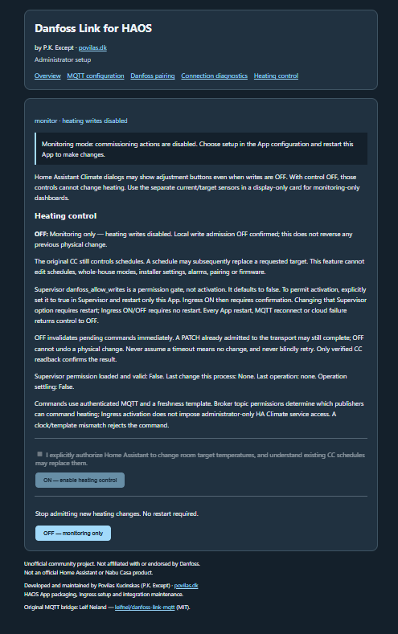

# Real screenshot gallery

These nine screenshots were supplied by the owner from the actual application
and Home Assistant. The owner explicitly approved publishing the original room
names, actual current/target temperatures, heating states, Climate/sensor names,
normal sensor values, alarm OK/count and system status.

Every output was recreated directly from the original archive, not from an
already-redacted image. Only the actual MQTT broker address and username are
covered by two small opaque masks. Image metadata is removed; all other pixels,
dimensions, labels and UI text are unchanged. No AI-generated screenshot,
reconstructed value, invented feature or replacement logo is used. The ZIP and
unprocessed source files remain outside Git.

**All five Ingress captures show App v0.3.0**, in an existing monitoring
installation. They do not document v0.3.1 first-run setup, CA import or new readiness
guidance. HA/Core/Supervisor versions and exact capture times were not supplied
for this gallery. Normal recorded values and diagnostic read timestamps are
shown as captured; they are not live readings or new validation results.

## Home Assistant overview

The README hero is the owner's real **climate-devices-overview.png** capture.
Original room names and measured/target temperatures are visible with the owner's
approval. Visible widgets do not establish permission to change heating; controls may appear
while Heating Control is OFF.

## Controls

The actual device Controls section, with original room names, current/target
temperatures, Heating/Idle states and widget layout. No pixel redaction is
applied to this image.

## Sensors

Separate current/target-temperature sensor labels and controller-status entries.
Room names, temperature readings, alarm OK/count, system status and relative
read time are visible. Sensor names retain the original UI language. No pixel
redaction is applied to this image.

## Thermostat

The real Climate more-info dialog, with the original room name and actual
measured/target temperatures visible. No pixel redaction is applied. Dial artwork
and controls are unchanged; a
setpoint is not a measured room-air temperature or proof of physical warming.

## Overview — App v0.3.0

The actual monitoring-mode overview, with stored pairing status and commissioning
actions disabled. No identifying fields are visible in this supplied view.

## MQTT configuration — App v0.3.0

Only the actual broker address and MQTT username are hidden with small masks
inside their input fields. TLS port, all input/menu labels and explanatory text
remain visible. Password fields are empty; configuration actions are disabled
in monitoring mode. The screenshot shows
v0.3.0's file-based CA interface, not v0.3.1's public CA import form.

## Danfoss pairing — App v0.3.0

Stored pairing is present; the page shows the saved-identity action and physical
controller instructions. No private identity, certificate or pairing code appears.
This is not a new-user pairing capture or another physical pairing validation.

## Connection diagnostics — App v0.3.0

The version label, runtime readiness, MQTT status and normal last-successful-read
timestamp are retained. No pixel redaction is applied. A screenshot is a point-in-time view,
not polling-continuity or long-running stability evidence.

## Heating control — App v0.3.0, OFF

The actual OFF/permission/settling safety messages and controls. The loaded
Supervisor permission is false in this capture. No activation, heating command
or production connection was performed to prepare this gallery.

## Privacy and review

The owner approved the room names, actual temperatures, heating states and
normal sensor/system values shown here. Only security-sensitive values are
concealed: the MQTT broker address and account name. No passwords, private
controller identities, pairing codes, keys, certificates/fingerprints, tokens or
session identifiers are visible in these captures. The unused alternative
overview, ZIP and unprocessed source files are excluded. Public output dimensions
and checksums are in [manifest.json](manifest.json).

This approval applies to these owner-supplied examples; do not upload credentials
or other people's installation data in bug reports.

All nine final outputs were inspected visually. A pixel comparison verified
that eight images preserve every original pixel. The MQTT image differs only
inside the two approved security-value masks, which are fully opaque.
PNG outputs contain only IHDR, pHYs, IDAT and IEND chunks; no text/EXIF/time metadata.
The existing project icon and logo are unchanged.

## Remaining captures

- App Store listing and App information/Running status.
- An actual v0.3.1 setup/CA-import/readiness view, clearly labeled with its version.
- Heating Control ON, only from a separately authorized existing state or test.
- In-flight settling and safe setup/error states on an authorized test instance.

Do not pair, activate control, change settings or create a production failure
solely for a screenshot. Future captures must retain real UI, obtain the owner's
approval for visible installation data, remove security-sensitive values and
metadata, and identify the actual App version. No unavailable image
is represented by a broken link or fictional placeholder.
